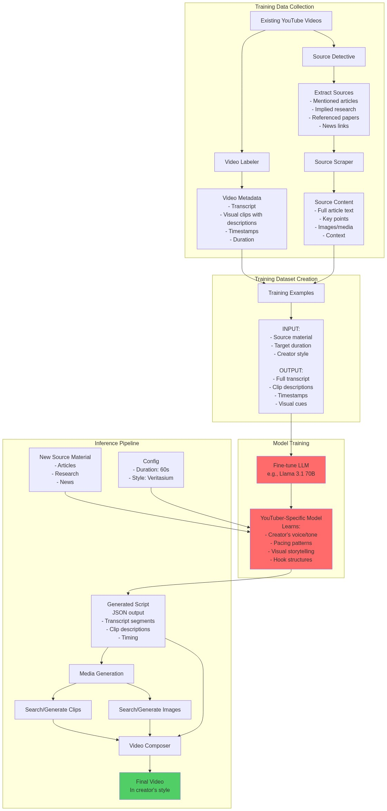
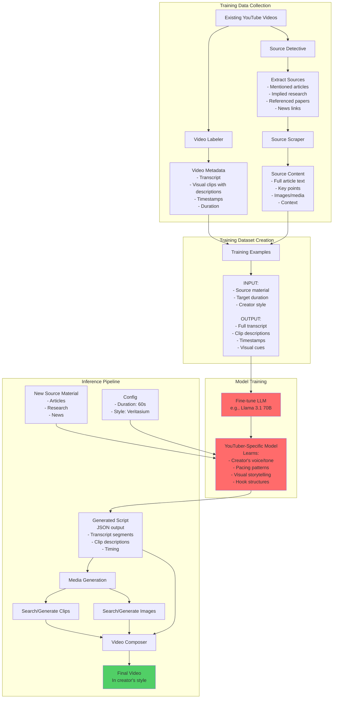
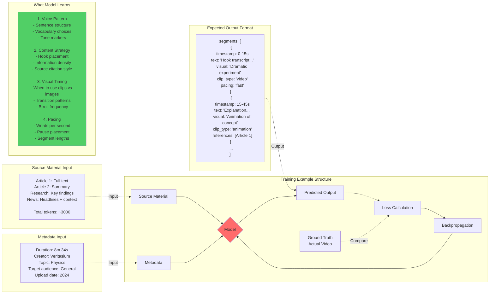
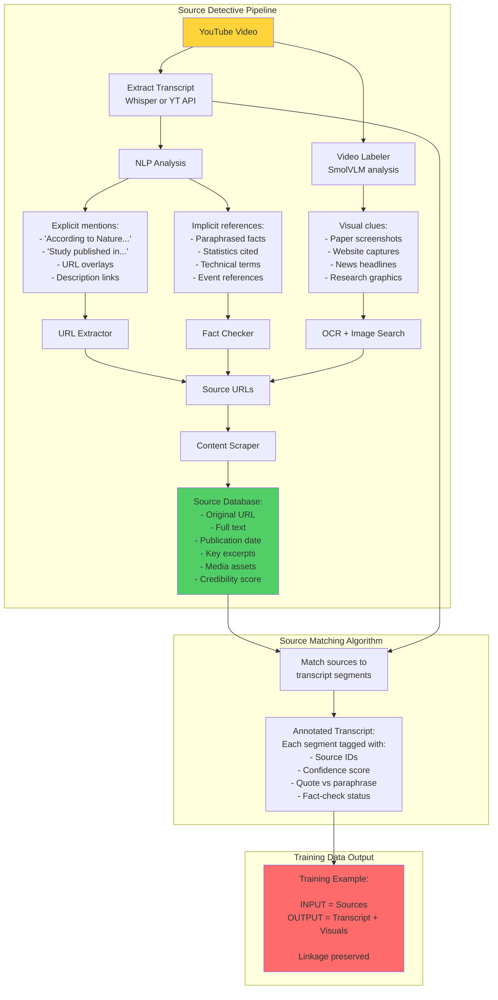
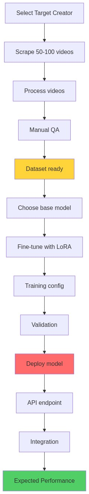
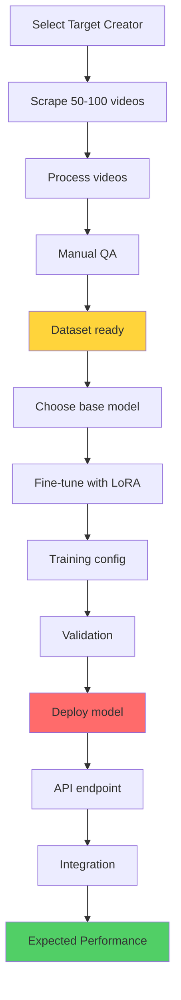

# YouTuber-Style Video Generation Training Pipeline

## Overview
This document outlines a system for training an LLM to create videos in the style of specific YouTubers by learning from their existing content and reverse-engineering their source material.

---

## 1. Complete Training Pipeline



<details>
<summary>View Mermaid Code</summary>


</details>

---

## 2. Training Example Breakdown


<details>
<summary>View Mermaid Code</summary>


</details>

---

## 3. Source Detective Pipeline


<details>
<summary>View Mermaid Code</summary>


</details>

---

## 4. Implementation Roadmap



<details>
<summary>View Mermaid Code</summary>


</details>

---

## Key Components Explained

### 1. Video Labeler
Uses your existing SmolVLM system to:
- Extract visual descriptions frame-by-frame
- Identify clip-worthy segments
- Detect on-screen text and graphics
- Generate timestamps for all visual elements

### 2. Source Detective (Critical Component)
Reverse-engineers what research the creator used:
- **Explicit mentions**: "According to a study in Nature..."
- **Visual clues**: Screenshots of papers, websites, graphs (OCR)
- **Implicit references**: Paraphrased facts, statistics, technical terms
- **Description links**: URLs in video description

### 3. Training Dataset Format

Each example maps:
```
INPUT:
- Source 1: [Full article text from Nature.com]
- Source 2: [Research paper summary]
- Source 3: [News article with context]
- Metadata: duration=514s, creator="Veritasium", topic="Physics"

OUTPUT:
- Segment 1: {text: "Hook...", visual: "Experiment", clip_type: "video", time: 0-15s}
- Segment 2: {text: "Content...", visual: "Animation", references: [Source 1], time: 15-45s}
- ...
```

### 4. What Makes This Work

**Patterns the model learns:**
- **Voice fingerprint**: Sentence structures, vocabulary, tone markers unique to creator
- **Content strategy**: How they transform dry research into engaging narratives
- **Visual timing**: When to use clips vs images, transition patterns
- **Pacing**: Words per second, pause placement, segment lengths
- **Hook structures**: Opening patterns that grab attention
- **Citation style**: How they reference sources (if at all)

### 5. Implementation Challenges

**Hardest part: Source Detective**
- Need NLP to detect citations and paraphrases
- OCR for on-screen text
- Reverse image search for screenshots
- Manual QA to verify source matches

**Solutions:**
- Start with creators who explicitly cite sources (easier)
- Use LLMs to suggest likely sources based on content
- Build confidence scores (high confidence = direct quote, low = inferred)
- Manual review for first 50-100 examples

### 6. Resource Requirements

**Training:**
- Base model: Llama 3.1 70B or Mixtral 8x22B
- Method: LoRA fine-tuning (4-8GB VRAM overhead)
- Cost: ~$50-100 on cloud GPU (RunPod, Lambda Labs)
- Time: 1-2 weeks for 100 examples

**Inference:**
- 4-bit quantized model (~40GB)
- RTX 4090 or A6000 sufficient
- Generation time: ~30 seconds per script
- Can run locally or via API

### 7. Expected Results

**After 100 training examples:**
- ✅ Voice/tone matches 80-90%
- ✅ Pacing and timing accurate
- ✅ Visual selection appropriate
- ⚠️ May need manual editing for polish

**After 500+ examples:**
- ✅ Near-perfect voice match
- ✅ Minimal editing needed
- ✅ Can handle multiple creator styles
- ✅ Production-ready quality

---

## Next Steps

1. **Prototype Source Detective** with 10 videos
2. **Manual annotation** to validate approach
3. **Build training pipeline** for 50-100 videos
4. **Fine-tune model** with LoRA
5. **Evaluate outputs** against held-out examples
6. **Integrate** with current video generation system

This approach transforms generic AI content into creator-specific videos by learning from how real YouTubers transform research into engaging narratives.
